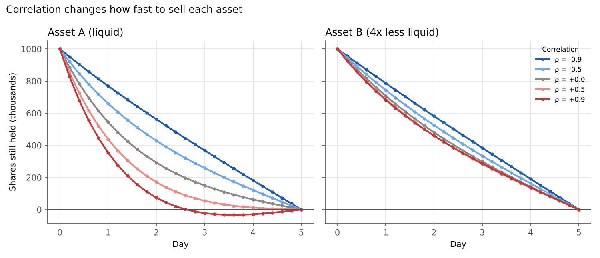

# Optimal liquidation of a correlated two-asset portfolio

How should you sell a large position in two assets over a few days, when selling moves prices and the assets' prices move together? This project works through that question in the classic Almgren–Chriss framework, extended to several assets with correlated prices and cross-asset price impact.

It is motivated by Chen, Feng, Peng & Zhang, [*Optimal portfolio execution with a Markov chain approximation approach*](https://doi.org/10.1093/imaman/dpab025) (IMA Journal of Management Mathematics, 2023), which studies how cross-asset impact and correlations shape the optimal liquidation of a multi-asset portfolio. This is a **simplified model inspired by that paper, not a replication of it**. See [How this differs from the paper](#how-this-differs-from-the-paper).

```bash
pip install numpy matplotlib
python experiments.py      # prints every table below and saves plots/ (about 2 s)
```

`execution.py` holds the model and solver. `experiments.py` runs everything in this write-up.

## The problem

Selling fast moves the price against you (**impact cost**). Selling slowly leaves you holding the position while the price wanders (**risk**). A trader with risk aversion λ picks the strategy that minimises

> expected cost + λ × variance of cost

where cost is the **implementation shortfall**: the value of the position at the starting price minus the cash actually received.

## Model

Holdings x₀, …, x_N over N periods of length τ, starting at x₀ = X and ending at x_N = 0. In period k the trader sells n_k = x_{k−1} − x_k.

- **Prices** follow correlated random walks with covariance C per day, C_ij = ρ_ij σ_i σ_j.
- **Permanent impact:** selling n_k lowers every later price by Γ n_k.
- **Temporary impact:** period-k sales execute at S_{k−1} − H n_k / τ. Off-diagonal entries of H and Γ are **cross-asset impact**: selling A also pushes B's price down.

The expected cost and the variance are both quadratic in the holdings:

- E[cost] = Σ_k n_k · Γ (Σ_{j<k} n_j) + Σ_k n_k · H n_k / τ
- Var[cost] = τ Σ_k x_k · C x_k

so the optimal trajectory solves a single linear system (`optimal_trajectory` in `execution.py`).

**Parameters.** Asset A is the example from Almgren & Chriss (2000): 1M shares at $50, volatility 0.95 $/share/√day (about 30% a year), η = 2.5×10⁻⁶, γ = 2.5×10⁻⁷, a 5-day horizon split into 25 periods, and λ = 10⁻⁶ (the paper's fixed bid-ask cost ε is left out). Asset B is identical except that it is **4× less liquid** (4× the impact).

## Results

### 1. The solver is checked two ways

- For one asset, it matches the Almgren–Chriss closed-form solution x_j = X sinh(κ(T − t_j)) / sinh(κT) to **2×10⁻⁹ shares**.
- A Monte Carlo simulation that generates 200,000 price paths and executes the trades gives a mean shortfall of **$896,861 ± 3,514** (95% CI) against the formula's **$896,204**, and a standard deviation of $801,698 against $801,877.

### 2. One asset: the optimum sits between the two extremes

| Strategy | Expected cost | Std dev | E + λ·Var |
|---|---|---|---|
| Sell immediately | $12,500,000 | $0 | $12,500,000 |
| Even pace (TWAP) | $620,000 | $1,189,588 | $2,035,120 |
| **Optimal** | **$896,204** | **$801,877** | **$1,539,210** |

The optimal strategy accepts about $276k more expected cost than an even pace in exchange for cutting the standard deviation by about a third. More risk aversion front-loads the selling ([plot](plots/1_trajectories_by_risk_aversion.png)), and the optimal strategies trace out an efficient frontier ([plot](plots/2_efficient_frontier.png)).

### 3. Two assets: correlation changes how fast to sell each one

| ρ | A held after 1 day | B held after 1 day | Lowest A position |
|---|---|---|---|
| −0.9 | 769,311 | 786,621 | 0 |
| −0.5 | 660,223 | 743,599 | 0 |
| 0 | 543,823 | 707,937 | 0 |
| +0.5 | 437,889 | 688,015 | 0 |
| +0.9 | 353,854 | 682,757 | **−33,045** |



- **Negative correlation** makes the two positions hedge each other, so holding both is less risky and the optimum sells both slowly, close to an even pace.
- **Positive correlation** makes holding both riskier. The optimum dumps the **liquid** asset A much faster and keeps the slow, expensive pace on B.
- At **ρ = +0.9**, the optimum sells **past zero** in A, going short about 33,000 shares between days 3 and 4 to hedge the B shares it still holds, then buys them back.

### 4. Hedging with an asset you don't own

Start with 1M shares of B and **no** A. The optimum still trades A, purely as a hedge:

| ρ | Peak A position | E + λ·Var | Selling B alone | Saved |
|---|---|---|---|---|
| −0.9 | +245,443 | $3,411,979 | $3,707,444 | 8.0% |
| −0.5 | +129,975 | $3,620,341 | $3,707,444 | 2.3% |
| 0 | 0 | $3,707,444 | $3,707,444 | 0.0% |
| +0.5 | −129,975 | $3,620,341 | $3,707,444 | 2.3% |
| +0.9 | −245,443 | $3,411,979 | $3,707,444 | 8.0% |

With positive correlation it shorts A while B is being sold, and with negative correlation it buys A. Both hedges unwind by the end ([plot](plots/4_hedging_with_asset_A.png)). The results are symmetric in ρ because flipping the sign of ρ just flips the sign of the hedge.

### 5. Ignoring correlation is costly

Planning each asset separately, as if ρ = 0, and then trading under the true correlation:

| ρ | Joint plan | Separate plans | Extra |
|---|---|---|---|
| −0.9 | $3,374,057 | $3,777,015 | 11.9% |
| −0.5 | $4,318,960 | $4,430,188 | 2.6% |
| +0.5 | $5,970,687 | $6,063,119 | 1.5% |
| +0.9 | $6,428,630 | $6,716,292 | 4.5% |

The penalty is largest for strong **negative** correlation: the separate plans sell quickly to cut risk that, jointly, was already hedged away.

### 6. Cross-asset impact (ρ = 0)

| Cross-impact | A held after 1 day | B held after 1 day | E + λ·Var |
|---|---|---|---|
| 0 | 543,823 | 707,937 | $5,246,654 |
| 0.5 | 567,146 | 757,776 | $6,629,548 |
| 0.9 | 502,632 | 824,529 | $7,651,399 |

(Cross-impact is the off-diagonal of H and Γ as a fraction of the geometric mean of the own-impact terms.)

At moderate cross-impact both assets are sold more slowly, because every sale now also hurts the other position. At strong cross-impact the optimum instead **separates the two sales in time**: it sells A *faster* than without cross-impact and B much more slowly, so the two sales overlap less ([plot](plots/5_cross_impact.png)).

## How this differs from the paper

| | Chen, Feng, Peng & Zhang (2023) | This project |
|---|---|---|
| Price model | Multi-dimensional geometric Brownian motion | Arithmetic random walk (Almgren–Chriss) |
| Risk measure | Quadratic variation | Variance of cost |
| Method | Markov chain approximation | Exact solution of a linear system |

The quadratic setup here is what makes the exact solution possible. The paper's setting is more realistic and needs the numerical Markov chain method.

## Open questions

- **Geometric prices.** Under geometric Brownian motion the risk of holding a position grows with the price level. For the same parameters, how far is the paper's optimal trajectory from the one here, and does the short position at ρ = +0.9 still appear?
- **No shorting.** At ρ = +0.9 the static optimum goes short in A. Adding x ≥ 0 turns the problem into a quadratic program. How much of the benefit survives?
- **Asymmetric cross-impact.** Here Γ and H are symmetric. In practice, selling a liquid asset may move an illiquid one more than the reverse. What changes when the impact matrices are not symmetric?
